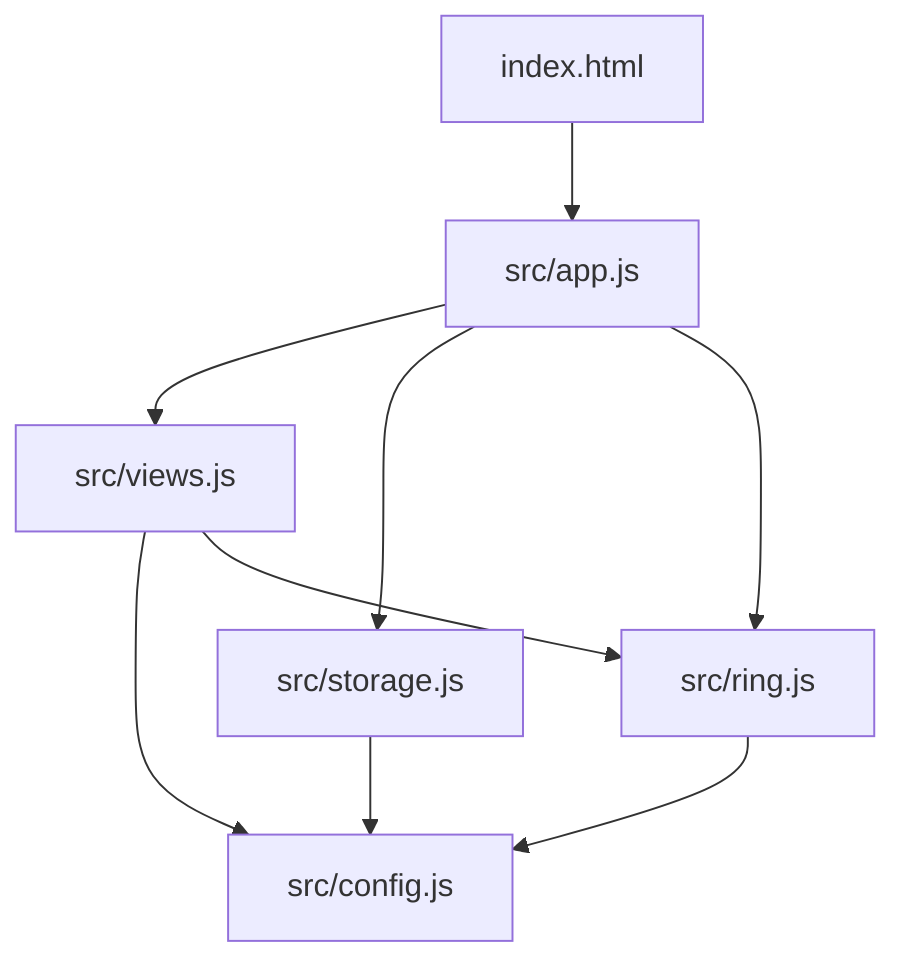

# Technische Architektur

## Laufzeit

Browser mit ES-Modulen; Einstieg: `index.html` lädt geordnet CSS sowie `src/app.js`. Letzteres importiert nur die benötigten Module. GitHub Pages liefert unveränderte Dateien aus. Service Worker für Offline-Fallback.



## Zuständigkeiten

| Datei | Zuständigkeit |
| --- | --- |
| `src/config.js` | Icons, Konstanten, sichere Textausgabe, Kalenderhelfer |
| `src/storage.js` | lokale Einträge, Demo, Kennzahlen, Export-Format-Grundlage |
| `src/ring.js` | Öffnungsgrad, Fortschritts-/Lichtimpuls, Splash-Übergang |
| `src/views.js` | HTML für Heute, Verlauf, Mehr, Setup und Navigation |
| `src/app.js` | Datenzustand der Session, DOM-Events, Modal, Check-in-Bearbeitung |
| `styles/base.css` | ältere gemeinsame Styles (technische Schuld, noch nicht in einem Schritt entfernt) |
| `styles/layout.css` | responsive Ansicht und Komponenten |
| `styles/ring.css` | letzte Ring-Layer-Styles und Animationen |

## Datenmodell

`localStorage['less.prototype.v1']` speichert ein JSON-Objekt:

```json
{"isDemo":false,"habit":"Weniger Scrollen.","mode":"reduce","goal":"Maximal 45 Minuten","created":"2026-11-14","checkins":{"2026-11-14":"yes"}}
```

`mode`: `reduce` oder `abstain`. Check-in pro Datum im lokalen Format `YYYY-MM-DD` mit `yes`, `no` oder keinem Eintrag. Nicht erfasste Tage zählen nicht automatisch als negatives Ergebnis. Bestehende Schlüssel/Datumslogik ohne Migrationsplan nicht ändern.

## Veröffentlichungsprozess

1. Feature-Branch erstellen (GitHub Pages zeigt weiter `main`).
2. Nur relevante Module ändern; `npm test` ausführen.
3. Auf dem iPhone die Änderungen prüfen, insbesondere Progression, Ring-Glow, Modal, kleine Displays.
4. Erst nach Freigabe nach `main` mergen; dann Pages-Deployment prüfen.

## Aktueller Umbau

Dieser Refactor trennt den bisherigen Quelltext **ohne Änderung der Check-in-UX**. Bereits besprochen, aber noch nicht umgesetzt: dickere sichtbare Ringlinie, Zahl optisch zentrieren, primärer direkter Erfolgs-Check-in plus dezenter Zweitweg. Das ist eine separate Design-/Funktionsentscheidung.
