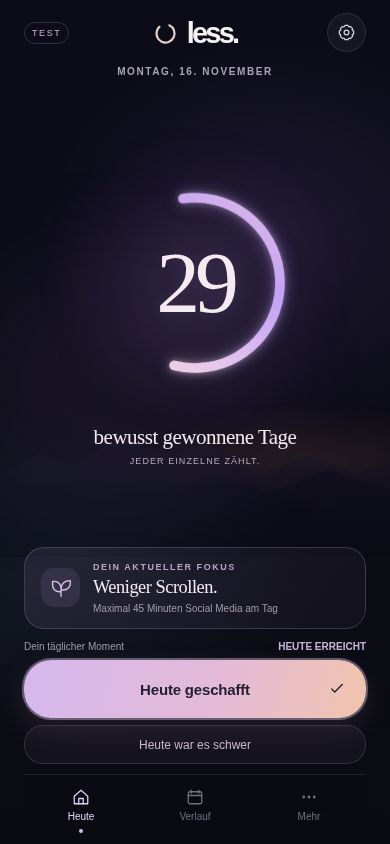
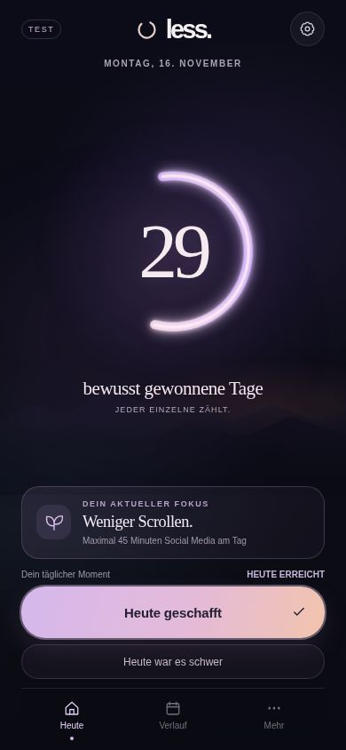
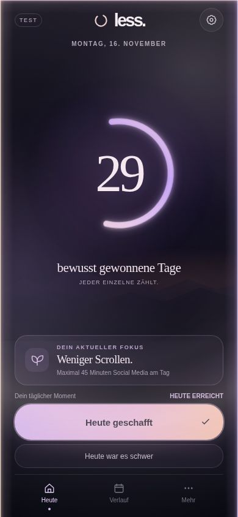

# Pearl Light 2.1 – Prüfergebnis

Stand 16. November 2026. Branch `codex/pearl-light-iphone`, Ausgangspunkt `7cfbe283c1b293c5f31cc2ef37cbc2049c79a797`.

## Befund und Änderung

In der ersten Pearl-Light-Optimierung war die CSS-Zuweisung `filter:url(#trueBloom)` am sichtbaren Dashboard-Ring entfernt worden. Die Filterdefinition blieb zwar im SVG, wurde dort aber nicht angewendet. Die Woge startete außerdem mit einer festen Skalierung von 0,12 und war dadurch erheblich kleiner als die sichtbare Ringkontur.

Der originale Bloom wird jetzt in einer separaten SVG-Bildfläche untergebracht. Die statische Bildfläche übernimmt dieselbe Geometrie und denselben Farbverlauf wie der Fortschrittsring. Sie bleibt im Ruhezustand dezent sichtbar. Eine zweite, ebenfalls statische Bildfläche hellt die offene Kontur beim positiven Check-in kurz auf. Beide Lichtflächen werden ausschließlich über ihre Deckkraft animiert. Der SVG-Zahlenlauf bleibt separat und verändert die Glow-Bilder nicht in jedem Frame.

Die Woge beginnt auf der Heute-Ansicht am gemessenen Ringradius, berechnet aus 130 Einheiten Radius im bestehenden 400er-SVG. Der Konturimpuls erreicht nach etwa 130 ms seine größte Helligkeit. Gleichzeitig setzt die Woge ein. Eine statische, weich auslaufende Innenmaske der ersten Wogenschicht hält den Start an der Kontur. Die zweite Perlmutt-Schicht bewahrt das weiche Lichtvolumen. Die beiden bisherigen Farbverläufe und die Gestaltung des dünnen Randglows werden weiterverwendet. Die Randzeitpunkte berücksichtigen nun den größeren Startdurchmesser.

Die Woge endet nach 1,95 Sekunden, die Tiefenschicht nach 2,28 Sekunden und der Rand nach 2,35 Sekunden. Der Ring kehrt innerhalb von etwa einer Sekunde zu seinem Ruheglow zurück. Der Konturimpuls ist an den sichtbaren Ring auf Heute gebunden. Die Bestätigung im Verlauf behält ihren bisherigen Ablauf mit Woge nach dem Schließen des Ergebnisses.

## Performance und Daten

- Die zusätzlichen Ringlichtflächen sind kleine, eigenständige SVG-Bilder. Ihre Filterparameter bleiben konstant. Während des Impulses wird ihre Deckkraft verändert.
- Die bestehende Woge animiert weiter nur gleichmäßige Skalierung und Deckkraft. Die Innenmaske wird statisch festgelegt. Die Geometrie wird einmal beim Auslösen gelesen.
- Die bestehende Aufräumlogik entfernt auch den Ringimpuls bei Navigation, Größenwechsel, Hintergrundwechsel, reduzierter Bewegung und erneutem Auslösen.
- Speicherung, Datenschema und Schlüssel bleiben unverändert. Der Effekt startet nach erfolgreichem positivem Speichern.
- App-Assets sind mit `20261116-pearl21` versioniert. Der aktuelle Vorschau-Cache heißt `less-preview-2026-11-16-pearl21`.

## Tatsächlich geprüft

| Prüfung | Ergebnis |
| --- | --- |
| Syntax und Git-Diff | Node-Syntaxprüfung und `git diff --check` bestanden. Änderungen dieser Phase liegen ausschließlich unter `preview/`. |
| Vorhandene Daten | Browser-Fixture blieb beim Start bytegleich. Frühere Einträge und Live-Speicherschlüssel blieben erhalten. |
| Ringbilder und Ruheglow | Beide eingebetteten SVG-Bilder wurden im Chromium-Browser geladen. Ruheglow vor und nach dem Impuls mit Deckkraft 0,55 bestätigt. |
| Wogenursprung | Im Browser und Node-Test geprüft, dass Startskalierung und tatsächlicher Ringradius übereinstimmen. |
| Positiv und Wiederholung | Ringimpuls und Woge starten nach Speicherung. Schnelles Wiederholen erzeugt genau einen Effekt und keine doppelt gezählten Tage. |
| Negativ und Speicherfehler | Negativer Check-in bleibt ohne Woge. Simulierter Schreibfehler erzeugt keinen positiven Effekt und bewahrt den vorherigen Status. |
| Verlauf, Reload, Navigation | Bestehender Bestätigungsablauf, Datenerhalt und vollständiges Aufräumen im Browser bestanden. |
| Reduzierte Bewegung | Im Browser simuliert. Woge und Konturimpuls unterdrückt, Speicherung erfolgreich. |
| Offline | Vorschau-Server gestoppt und App erneut geladen. Negativer Check-in vorhanden, beide Glow-Bilder geladen, positiver Check-in gespeichert und nach weiterem Reload vorhanden. |
| Cache-Grenzen und Fehler | Bestehender Node-Test für Installation, Vorschau-Cache-Update, Live-Cache-Erhalt, Scope-Grenzen, HTTP-Fehler und Cache-Schreibfehler bestanden. |
| Darstellung | Ruheglow und eingefrorene Animationsphasen bei 390 × 844 CSS-Pixeln geprüft. Bei 320 × 568 Pixeln liegen Check-in-Tasten und Navigation im sichtbaren Bereich. |

Die Node-Tests arbeiten mit simulierten DOM- und Cache-Schnittstellen. Browserprüfungen liefen mit isolierten Testdaten in Chromium. Ein echter Wechsel der iOS-Bewegungseinstellung und Frame-Pacing auf einem iPhone wurden für 2.1 noch nicht geprüft.

## Momentaufnahmen

Die beiden Impulsaufnahmen wurden bei der angegebenen Zeit angehalten. Es handelt sich um tatsächliche Browser-Renderings.

| Ruheglow | Konturimpuls bei 130 ms | Woge bei 650 ms |
| --- | --- | --- |
|  |  |  |

## Gerätetest und private Site

Matis hat für Pearl Light 2.0 auf einem echten iPhone flüssige Animation, eine schöne Perlmutt-Woge, einen gelungenen Übergang zum Rand und zuverlässiges wiederholtes Auslösen bestätigt. Für 2.1 steht die Bestätigung der neuen Ringanbindung und der weiterhin flüssigen Darstellung auf diesem Gerät aus.

Die bestehende private Test-Site wird mit diesem Stand aktualisiert. Für den Test in Safari die [Testadresse](https://less-pearl-light-matis.ein-schmuh.chatgpt.site/) neu laden. Der Seitentitel nennt `Pearl Light 2.1 Test`. Bei einem bereits geöffneten älteren Stand nach kurzer Wartezeit nochmals laden. Die gespeicherten Testeinträge bleiben auf demselben Ursprung.

Zu prüfen sind besonders die ersten 300 ms, der Übergang vom aufgehellten Ring in die Woge, die Rückkehr zum Ruheglow und schnelles Wiederholen. Die Freigabe von 2.0 ersetzt diesen neuen iPhone-Test nicht.
