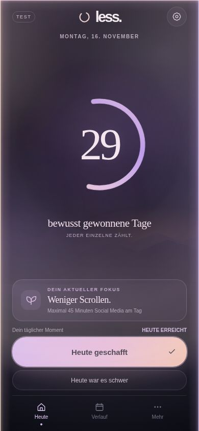
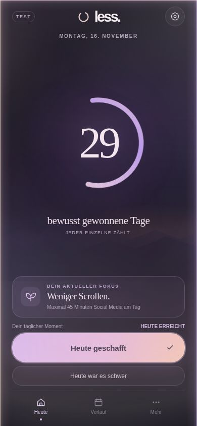

# Pearl Light 2.0 – Prüfergebnis

Stand 16. November 2026, Branch `codex/pearl-light-iphone`. Ausgangspunkt war Commit `d31d68ce856d57a22762d47a85376df4190b40da`.

## Umsetzung

Die Woge besteht aus zwei kleinen, statisch gezeichneten Verlaufsebenen mit leicht versetztem Ablauf. Pfirsich, Rosé und Lavendel überlagern sich zu einem breiten Lichtvolumen. Beide Ebenen skalieren gleichmäßig. Die Randflächen sind schmal und laufen von einer etwa 1 px hellen Kante über 22 px weich nach innen aus. Ihr Einsatz wird aus dem Abstand zum Wogenzentrum berechnet. Die Gesamtwirkung dauert 2,35 Sekunden.

Während des Lichteffekts animieren ausschließlich Skalierung und Deckkraft. Es gibt keine Canvas-Neuzeichnungen, animierten Filter oder wiederholten Layoutmessungen für die Woge. Die bestehende SVG-Fortschrittsanzeige aktualisiert ihren Bogen weiterhin während des Zahlenlaufs. GPU-Compositing und Bildrate hängen vom Browser und Gerät ab und wurden auf iOS noch nicht gemessen.

Neue Eingaben, Navigation, Größenwechsel, Hintergrundwechsel und Änderungen der Bewegungseinstellung räumen den Effekt samt Listenern auf. Ein verzögertes Ende eines älteren Effekts kann einen neu gestarteten Effekt nicht entfernen. Ein zusätzlicher Zeitablauf beendet auch unterbrochene CSS-Animationen.

Die Speicherlogik verwendet die bisherigen Datenformate und Schlüssel. Zusätzlich ist die Cache-Suche auf den aktuellen Vorschau-Cache beschränkt. Erfolgreiche Online-Antworten bleiben auch bei einem fehlgeschlagenen Cache-Schreibvorgang nutzbar. Service Worker können für den lokalen Test auch auf einem sicheren Loopback-Ursprung registriert werden.

## Tatsächlich geprüft

| Prüfung | Methode und Ergebnis |
| --- | --- |
| JavaScript-Syntax und Diff | Node-Syntaxprüfung, `git diff --check`, Kontrolle der geänderten Pfade bestanden. |
| Vorhandene Check-ins | Browser-Test mit gespeicherten Beispieldaten. Initialisierung ließ den gespeicherten Datensatz bytegleich, ältere Einträge blieben bei neuen Check-ins erhalten. |
| Positiv, negativ, mehrfach | Im Chromium-Browser bestanden. Positiv startet nach Speicherung, negativ erzeugt keine Woge, wiederholtes Tippen zählt denselben Tag nur einmal. |
| Speicherfehler | Schreibfehler im Browser simuliert. Fehlermeldung sichtbar, vorheriger Status blieb bestehen, keine positive Woge gestartet. |
| Verlauf und Reload | Änderung über das Dialogfenster, Abschluss über den Schließen-Button und Reload im Browser bestanden. Escape wurde zusätzlich im Node-Test geprüft. |
| Bewegung und Aufräumen | Reduzierte Bewegung im Browser simuliert. Check-in gespeichert, Woge unterdrückt. Navigation und Größenwechsel entfernten den Effekt. Echter iOS-Einstellungswechsel steht aus. |
| Offline | Vorschau-Server nach erfolgreicher Cache-Installation gestoppt. Die App ließ sich im Chromium-Browser erneut laden. Negativer Check-in blieb nach Reload erhalten, anschließender positiver Check-in funktionierte. |
| Cache-Update und Trennung | Node-Test prüft Installation, Entfernen alter Vorschau-Caches, Erhalt eines Live-Cache-Fixtures, Scope-Grenzen und fehlenden Zugriff auf fremde Cache-Inhalte. |
| Netzwerk- und Cachefehler | Node-Test prüft Offline-Fallback, HTTP-503 mit vorhandenem Cache und fehlgeschlagenes Cache-Schreiben bei erfolgreicher Online-Antwort. |
| Layout und Lichtwirkung | Im Chromium-Browser bei 390 × 844 CSS-Pixeln visuell geprüft. Bei 320 × 568 Pixeln sind beide Check-in-Tasten und die Navigation im sichtbaren Bereich. |
| Daten- und Live-Grenzen | Node- und Browser-Test prüfen den unveränderten Live-Speicherschlüssel. Der Git-Diff dieser Phase enthält ausschließlich Dateien unter `preview/`. |

Die Browserprüfungen liefen in der internen Vorschau auf einem eigenen lokalen Ursprung mit Testdaten. Die reduzierte Bewegung wurde durch die Testumgebung simuliert. Die Node-Tests arbeiten mit vereinfachten DOM- und Cache-Schnittstellen. Sie ergänzen den Browser-Test.

## Momentaufnahmen

Die CSS-Animationen wurden für diese Aufnahmen bei der angegebenen Zeit angehalten. Die Bilder zeigen den tatsächlichen Browser-Render der Testversion.

| Lichtwoge bei 650 ms | Übergang zum Rand bei 1100 ms |
| --- | --- |
|  |  |

## Noch offen

- Echte iPhone-Bildrate und Frame-Pacing unter iOS Safari, auch bei Stromsparmodus und wiederholten Check-ins.
- Wirkung auf dem iPhone-Display mit Safari-Leisten, Safe Areas, Displayrundungen und als Homescreen-PWA.
- Echter Wechsel von „Bewegung reduzieren“, Hintergrundwechsel und Orientierung auf iOS.
- Vollständiger Offline-Start und Aktualisierung einer vorhandenen Vorschau-PWA auf dem iPhone über HTTPS.
- Ausführung des Windows-Startskripts auf Windows. Der Skriptinhalt wurde geprüft.

## Testadresse

Die interne Vorschau ist eine Entwicklungsumgebung und keine bereitgestellte iPhone-HTTPS-Adresse. Die sichere lokale Alternative ist in [README.md](README.md) beschrieben. Eine separate Hosting-Einrichtung braucht gemäß Auftrag eine Freigabe. Eine Live-Veröffentlichung wurde nicht durchgeführt.
